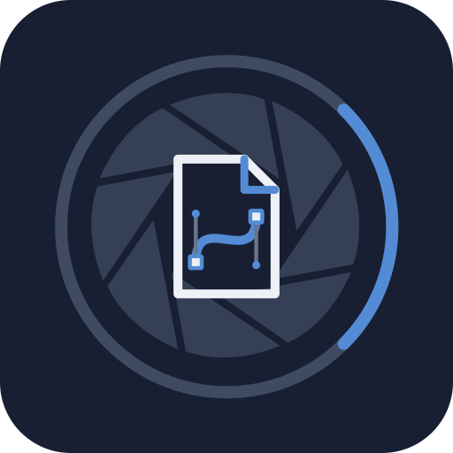

<p align="center">
  
</p>

# SvgKit

SvgKit is a pure Dart codec for reading, editing, and writing SVG and SVGZ documents. It combines immutable
document snapshots with an authoring API for paths, shapes, transforms, styles,
text, reusable resources and the complete retained XML tree. It has no Flutter
or rendering-engine dependency. SVGZ uses Focale's ZCodec.

## Supported data

- SVG and gzip-compressed SVGZ with UTF-8, BOM-marked UTF-16, or declared ISO-8859-1 input.
- Immutable XML snapshots retaining unknown elements, namespaces, comments, and extension data.
- Editable paths, shapes, transforms, styles, text, and reusable resources.
- Local reference inspection, ID renaming, and reference remapping during duplication or import.
- Configurable byte, node, and depth limits, including bounded SVGZ decompression.
- UTF-8 SVG and SVGZ output without inserting whitespace into text content.

## Installation

Add SvgKit to your Dart or Flutter project's `pubspec.yaml`:

```yaml
dependencies:
  svgkit: ^0.1.0
```

Run `dart pub get`, or `flutter pub get` for a Flutter project. The kit itself requires only Dart.

## Reading, editing, and writing

Edit a path, change its appearance, and save a compressed SVGZ snapshot:

```dart
import 'package:svgkit/svgkit.dart';

final SvgDocument original = SvgDocument.parse(
  source: '<svg xmlns="http://www.w3.org/2000/svg">'
      '<path id="outline" d="m10 10 h40 v30 z" fill="red"/>'
      '</svg>',
);
final SvgDocument edited = original.edit((editor) {
  final SvgEditableElement path = editor.elementById(id: 'outline')!;
  final SvgPathData absolute = path.pathData.normalized();
  path.setPathData(
    value: absolute.replace(
      start: 1,
      end: 2,
      replacement: [SvgPathCommand.lineTo(x: 70, y: 10)],
    ),
  );
  path.setStyleProperty(name: 'fill', value: '#3066be');
  path.setTransforms(
    value: path.transforms().prepend(
      transform: SvgTransform.translate(x: 5, y: 0),
    ),
  );
});
final List<int> saved = const SvgCodec(compressed: true).encode(edited);
final SvgDocument reopened = const SvgCodec().decode(saved);
```

The original snapshot never changes, including when the edit callback fails.
`SvgEditor(document: original)` supports longer sessions and repeated `build()`
snapshots. Application history can retain these immutable documents.

## Reusable `dart:convert` API

`SvgCodec` implements `Codec<SvgDocument, List<int>>` and keeps the output format
and resource limits in one immutable value:

```dart
const SvgCodec codec = SvgCodec(
  compressed: true,
  limits: SvgLimits(maxBytes: 16 * 1024 * 1024),
);

final SvgDocument decoded = codec.decode(saved);
final List<int> output = codec.encode(decoded);
```

Input compression is detected from the gzip signature, independently of the
`compressed` output option. The `List<int>` binary type allows composition with
standard codecs such as `base64`; direct `encode` calls return `Uint8List`.
`SvgDecoder` and `SvgEncoder` are also reusable converters. Each conversion
handles one complete in-memory document.

## Creating artwork

```dart
final SvgEditor editor = SvgEditor.empty(
  width: SvgLength(value: 200),
  height: SvgLength(value: 100),
);
final SvgEditableElement gradient = editor.linearGradient(
  id: 'sky',
  stops: [
    SvgGradientStop(offset: 0, color: '#4e8cff'),
    SvgGradientStop(offset: 1, color: '#b9f0ff'),
  ],
);
editor.definitions.insert(child: gradient);
final SvgEditableElement rectangle = editor.rectangle(
  width: SvgLength(value: 200),
  height: SvgLength(value: 100),
  radiusX: SvgLength(value: 12),
);
rectangle.setReference(property: 'fill', target: gradient);
editor.root.insert(child: rectangle);
final SvgDocument artwork = editor.build();
```

Constructors return detached elements; insertion is explicit. Run the complete
[editing example](example/svgkit_editing_example.dart) with
`dart run example/svgkit_editing_example.dart`.

## Authoring coverage

| Content | Editing API |
| --- | --- |
| Document tree | Insert, move, remove, import, duplicate, group and ungroup |
| Paths | Every M/L/H/V/C/S/Q/T/A/Z command, relative/absolute coordinates, exact arcs, editable command ranges |
| Shapes | Rectangles, circles, ellipses, lines, polygons and polylines; typed lengths/points |
| Viewports | Dimensions, viewBox, preserveAspectRatio and relative lengths with explicit context |
| Transforms | Ordered translate/scale/rotate/skew/matrix functions, including gradient/pattern transforms |
| Styling | Inline declarations, duplicates, `!important`, custom properties, classes; complete stylesheet text |
| Text | Text runs, tspan/textPath structure, font/position attributes and mixed content |
| Paint/effects | Gradient stops, patterns, clipping, masks, filter graphs and markers |
| Reuse/images | Symbols, use instances, href/XLink, external and data-URI images |
| References | ID renaming, duplicate remapping, recognized local links and dangling-link diagnostics |
| Other content | Generic elements/attributes, animation markup, metadata, comments and extensions |

Use `createElement`, `setAttribute` and `replaceContent` for SVG features without
a dedicated convenience constructor. Retained data is not flattened or removed
because a host editor cannot render it. Detached XML access from 0.1.0 remains
available and compatible.

## Scope and validation

This is a **document editing kit**. Rendering, computed CSS, font shaping,
hit-testing, Boolean path operations, animation execution and application scene
conversion belong to the host. Full XML authoring does not imply browser-level
SVG rendering conformance. Structural edits can change CSS/compositing; scripts,
external styles and advanced CSS reference forms require explicit caller edits.
See the precise contracts in [docs/SVG.md](docs/SVG.md).

Codecs support UTF-8, BOM-marked UTF-16, declared ISO-8859-1 and SVGZ with byte, node and depth limits.
Internal DTD subsets are rejected. No resources are fetched and no scripts are
executed; output is not sanitized for browser embedding.

## More documentation

- [SVG technical reference](docs/SVG.md)
- [Codec example](example/svgkit_example.dart)
- [Creation and editing example](example/svgkit_editing_example.dart)
- [Validation evidence](docs/validation.md)
- [Contributing](CONTRIBUTING.md)

## Development

```sh
dart pub get
dart format --output=none --set-exit-if-changed .
dart analyze
dart test
dart test --platform node
```

The [pinned corpus](test/corpus/README.md) contains 94 W3C files. Recorded librsvg
checks cover 93 accepted documents and a separately authored visible-edit
reference. See the validation evidence above for the scope and reproduction
commands. Ordinary unit tests run offline.

---

Built for **[Focale](https://focale-editor.app)**, an advanced local image editor. Discover what these packages make possible in a real creative workflow.
